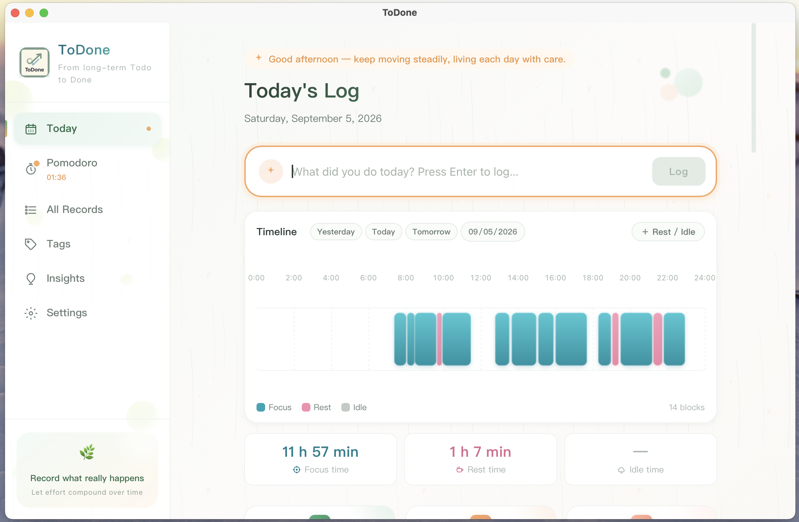

# ToDone

**From longterm Todo to Done**

| end | tech stack | catalog |
|---|---|---|
| Windows / macOS | Tauri 2 · React 18 · TypeScript · Vite 5 · SQLite | `donelist/` |

---

## 功能特性

- **今日页**：快捷录入、按"昨天 / 今天 / 明天 + 自选日期"切换查看，历史日期可编辑
- **每日时间线**：以三色块展示一天的时间分布
- **番茄钟**：专注 / 休息双模式
- **标签 / 洞察 / 年度图表**：按领域、来源、难度、精力聚合复盘
- **中英双语**：设置页一键切换（163+ 词条），全站文案覆盖
- **数据安全**：SQLite 主存储 + localStorage 自动降级，自动备份（60s 防抖，保留 10 份）、手动导出 / 导入（JSZip）

